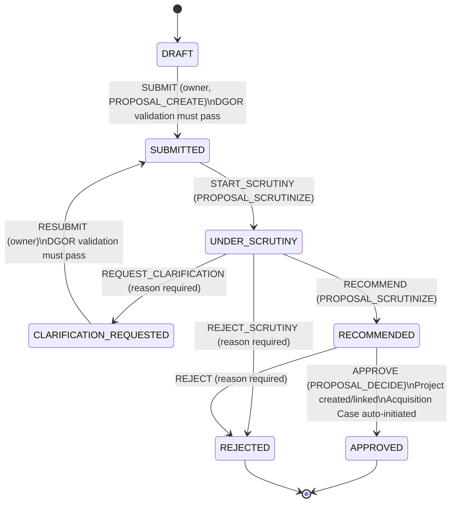
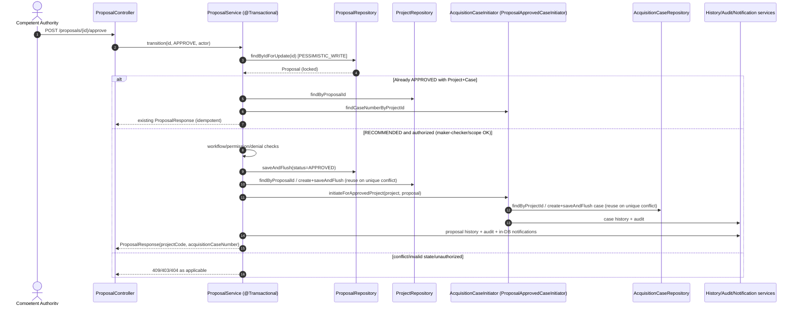

# LandNexus NLAMS Workflow Implementation Changelog

**Date:** 2026-11-12  
**Scope:** Incremental, backward-compatible implementation of NLAMS proposal-to-acquisition workflow capabilities in the existing LandNexus modular monolith (Spring Boot backend + React/TypeScript frontend).

> **Deferred integrations (explicit confirmation):** BhuNaksha, 7/12, 8A, Ferfar, PFMS/DBT, and ISRO Bhuvan integrations were **not implemented or modified** as part of this task. Existing simulated/unrelated functionality in these areas was left unchanged unless strictly necessary (none required).

---

## A. Implementation Summary

### Implemented
- **Automatic Acquisition Case initiation on proposal approval:** when a proposal is approved (and project created), the system now auto-initiates an Acquisition Case for the approved project (idempotent per project), seeds project villages, records case history/audit, and returns the acquisition case number in proposal responses.
- **DGOR-style system-assisted proposal validation (MVP):** added backend validation service and `GET /api/v1/projects/proposals/{id}/validation` endpoint to evaluate mandatory proposal fields, location/schedule/linear-project rules, and supporting-information readiness; validation failures now block `SUBMIT`/`RESUBMIT` transitions and are audited.
- **Frontend workflow visibility updates:** proposal details now show DGOR validation results (pass/warn/fail), revalidation action, and approved-proposal acquisition case number/linkage context; proposal API types updated for `acquisitionCaseNumber` and validation payloads.
- **Notification/audit enhancements in approval flow:** approval notification now includes acquisition case initiation outcome; validation and auto-initiation actions are audited.

### Reused existing functionality (not reimplemented)
- Existing proposal workflow/state machine, maker-checker rules, ownership/scope checks, status history, version snapshots, and project creation on approval (`ProposalWorkflow`, `ProposalService`, repositories, controllers).
- Existing acquisition case/lifecycle model, repositories, workflow/history infrastructure, and audit/notification infrastructure.
- Existing RBAC/geographic scope enforcement, REST conventions, Flyway migration discipline (no old migrations modified), and frontend routing/component patterns.

### Partially implemented / not fully completed
- Full DAA/DGOR terminology mapping in UI/state naming, configurable workflow-task assignment/routing engine with pending/accepted/completed/overdue task records, proposal-level supporting document association/upload/versioning/verification, comprehensive role-aware workflow dashboards/task screens beyond existing monitoring, and exhaustive automated test coverage for all newly requested scenarios (see **K. Pending Work**).

---

## B. Architecture

### Backend modules (relevant)
- `com.landnexus.projects.*` – proposal workflow, project creation, validation, proposal APIs/DTOs.
- `com.landnexus.acquisition.*` – acquisition case domain/repositories/lifecycle; added proposal-approval initiation integration.
- `com.landnexus.shared.*` – security, audit, notifications, workflow engine, exceptions, pagination.
- `com.landnexus.reporting.*` – existing dashboard/MIS/SLA monitoring (reused; not redesigned).
- `com.landnexus.administration.*`, `com.landnexus.landrecords.*` – lookup/scope and parcel-document capabilities reused by existing flows.

### Frontend feature modules (relevant)
- `src/features/proposals/*` – proposal list/details/form/actions/timeline/history/version UI.
- `src/api/proposals.ts`, `src/api/types.ts` – proposal API client and contracts.
- Existing `features/acquisition`, `features/monitoring`, `features/notifications`, `features/myWork` reused.

### Key design decisions
- **No reverse module dependency for approval → case creation:** introduced `AcquisitionCaseInitiator` interface in `projects.application` and `ProposalApprovedCaseInitiator` implementation in `acquisition.application` (adapter/port-style integration).
- **Idempotent acquisition initiation:** if a case already exists for the project, existing case number is returned; no duplicate case created.
- **Framework defaulting on auto-initiation:** NH/Expressway → `NATIONAL_HIGHWAYS_ACT_1956`, Railway → `RAILWAYS_ACT_1989`, others → `LARR_2013` (sensible defaults; can be refined by configuration/rules later).
- **Validation as backend-enforced gate:** submit/resubmit blocked on mandatory validation failures; validation endpoint available for pre-check/display.
- **Backward-compatible API evolution:** added optional `acquisitionCaseNumber` to `ProposalResponse`; new `GET /{id}/validation` endpoint added without breaking existing endpoints.

---

## C. Backend Changes

| File | Purpose | Main changes / business rules |
|---|---|---|
| `landnexus-backend/src/main/java/com/landnexus/projects/application/AcquisitionCaseInitiator.java` | Integration contract | New interface for initiating/finding acquisition case by approved project; decouples projects from acquisition implementation. |
| `landnexus-backend/src/main/java/com/landnexus/acquisition/application/ProposalApprovedCaseInitiator.java` | Approval integration | New service: idempotently creates acquisition case (`ACQ-YYYY-nnnnnn`) for approved project, copies project villages, sets default framework/note/description, records `AUTO_INITIATE` history and audit. |
| `landnexus-backend/src/main/java/com/landnexus/acquisition/infrastructure/AcquisitionCaseRepository.java` | Case lookup | Added `findByProjectId(UUID)` for idempotent initiation/lookup. |
| `landnexus-backend/src/main/java/com/landnexus/projects/application/ProposalValidationService.java` | DGOR validation | New configurable-ready validation service computing PASS/WARN/FAIL items for mandatory fields, location/department/villages, schedule, linear-project length, alignment warning, and supporting-documents readiness warning. |
| `landnexus-backend/src/main/java/com/landnexus/projects/application/ProposalService.java` | Core workflow orchestration | Injected validation and acquisition initiator; added `validate(id, actor)`; enforced validation on submit/resubmit; on approve creates project then auto-initiates acquisition case and returns case number; enhanced notifications/audit for validation and approval; response now includes acquisition case number. Preserved existing maker-checker/ownership/scope/transition rules. |
| `landnexus-backend/src/main/java/com/landnexus/projects/api/ProposalController.java` | Proposal API | Added `GET /api/v1/projects/proposals/{id}/validation` endpoint returning validation results. |
| `landnexus-backend/src/main/java/com/landnexus/projects/api/dto/ProposalResponse.java` | API contract | Added `acquisitionCaseNumber` field and factory overload (backward-compatible). |
| `landnexus-backend/src/main/java/com/landnexus/projects/api/dto/ProposalValidationResponse.java` | API contract | New DTO for validation results (`proposalId`, `passed`, `items[{code,severity,message}]`). |

---

## D. Frontend Changes

| File | Purpose | Main UI/API/permission changes |
|---|---|---|
| `LandNexus-frontend/src/api/types.ts` | Type contracts | Added `acquisitionCaseNumber?: string | null` to `ProposalResponse`; added `ProposalValidationItem`/`ProposalValidationResponse`. |
| `LandNexus-frontend/src/api/proposals.ts` | API client | Added `getProposalValidation(id)` calling `GET /projects/proposals/{id}/validation`. |
| `LandNexus-frontend/src/features/proposals/ProposalDetailsPage.tsx` | Proposal workflow screen | Added DGOR validation card with revalidate action, pass/warn/fail rendering, and error/loading states; displays acquisition case number/context for approved proposals alongside project code; reloads validation with workflow refresh. Uses existing read permissions/visibility rules. |
| `LandNexus-frontend/src/features/proposals/labels.ts` | UX messaging | Updated approve success message to reflect project creation and acquisition initiation start. |

> Existing proposal actions (submit/resubmit/scrutiny/clarification/recommend/approve/reject), timeline/history/version views, routing guards, and permission-aware rendering were reused.

---

## E. Database Changes

- **No new Flyway migrations added** in this increment.
- **No existing migrations modified.**
- Schema already contains required core tables for proposals/projects/history/versions/notifications and acquisition cases/history (`V5`, `V8`, `V9`, etc.); auto-initiation reuses existing `acquisition_cases`, `case_status_history`, and sequences.

### Compatibility considerations
- API response extension (`acquisitionCaseNumber`) is additive.
- New validation endpoint is additive.
- No destructive or backward-incompatible data changes introduced.

---

## F. API Documentation

### 1) `GET /api/v1/projects/proposals/{id}/validation` (new)
- **Permission:** `PROPOSAL_READ` or `PROPOSAL_READ_OWN` (existing controller read guard), subject to existing proposal visibility/scope checks.
- **Request:** path parameter `id` (UUID).
- **Response example:**
```json
{
  "proposalId": "6f2e...",
  "passed": false,
  "items": [
    { "code": "TITLE", "severity": "PASS", "message": "Title is provided." },
    { "code": "VILLAGES", "severity": "FAIL", "message": "At least one affected village must be selected." },
    { "code": "SUPPORTING_DOCUMENTS", "severity": "WARN", "message": "Proposal-level supporting document association is not yet available..." }
  ]
}
```
- **Validation/business rules:** computes current DGOR-style checks (mandatory fields, location/department/villages, schedule, linear length, alignment/supporting-doc warnings). Audits `VALIDATE` action.
- **Errors:** 401/403 per security, 404 if proposal not found/not visible.
- **Workflow state change:** none.

### 2) `POST /api/v1/projects/proposals/{id}/submit` and `/resubmit` (modified behavior)
- **Permission:** `PROPOSAL_CREATE` + existing owner/transition rules.
- **Behavior change:** backend runs mandatory validation; if failures exist, request is rejected with `400 Invalid request` ("Proposal validation failed...") and audited as `VALIDATION_FAILED`; on pass, audited as `VALIDATE` and normal submission/version/history flow continues.
- **Response:** existing `ProposalResponse` shape, now includes optional `acquisitionCaseNumber`.
- **Workflow state change:** only on successful transition as before.

### 3) `POST /api/v1/projects/proposals/{id}/approve` (modified behavior)
- **Permission:** `PROPOSAL_DECIDE` + existing maker-checker/scope/transition rules.
- **Behavior change:** after project creation, system auto-initiates acquisition case for project (idempotent), audits `AUTO_INITIATE`, includes case number in response and approval notification.
- **Response:** existing `ProposalResponse` plus `acquisitionCaseNumber` when available.
- **Workflow state change:** proposal `RECOMMENDED -> APPROVED` (existing), project created/linked (existing), acquisition case created/linked in `INITIATED` state when applicable (new integration).

### 4) Existing proposal read endpoints (response extended)
- `GET /api/v1/projects/proposals`, `GET /api/v1/projects/proposals/{id}`, transition-returning endpoints now may include `acquisitionCaseNumber` (nullable/additive).

> Existing acquisition lifecycle APIs/controllers/services were reused as-is for post-initiation tracking.

---

## G. Workflow Documentation

### Complete workflow (implemented + mapped to existing engine)



### Status definitions (proposal)
- **DRAFT:** editable by owner before submission.
- **SUBMITTED:** formally submitted; awaiting scrutiny (business mapping for DAA submission stage).
- **UNDER_SCRUTINY:** under review by scrutiny officer.
- **CLARIFICATION_REQUESTED:** additional information required; editable/resubmittable by owner.
- **RECOMMENDED:** scrutiny recommendation complete; awaiting competent authority decision.
- **APPROVED:** final approval; project created and acquisition initiation triggered.
- **REJECTED:** final rejection with mandatory reason.

> DGOR/system validation is implemented as an enforced gate on submit/resubmit and exposed via validation endpoint/history-audit records (mapped onto existing statuses without introducing conflicting duplicate states).

### Allowed transitions and responsible roles
- `SUBMIT`, `RESUBMIT`: owner with `PROPOSAL_CREATE` (existing).
- `START_SCRUTINY`, `REQUEST_CLARIFICATION` (reason), `RECOMMEND`, `REJECT_SCRUTINY` (reason): `PROPOSAL_SCRUTINIZE`, non-owner reviewer (existing).
- `APPROVE`, `REJECT` (reason): `PROPOSAL_DECIDE`, non-owner, not recommender (maker-checker, existing).

### Maker-checker rules (preserved)
- Creator cannot review own proposal.
- Recommender cannot approve/reject the same proposal.
- Only authorized role can perform transition; denial enforced in workflow/service.
- Rejection requires reason; clarification requires reason.

### Task assignment and routing
- **Current:** notification-based routing to eligible role users in district scope for scrutiny/decision stages (existing `notifyRole` behavior); approval initiates next acquisition stage by creating case.
- **Pending full implementation:** explicit workflow task entity/state tracking (pending/accepted/completed/overdue), configurable authority resolution rules UI/API, reassignment workflow, and “current responsible authority” task records (see Pending Work).

### Clarification and rejection paths
- Clarification: `UNDER_SCRUTINY -> CLARIFICATION_REQUESTED` (reason, history/audit preserved) -> owner edits/resubmits -> `SUBMITTED` after validation passes.
- Rejection: from scrutiny or recommended with mandatory reason; terminal `REJECTED`.

### Automatic Project and Acquisition Case initiation
- On `APPROVE`: project created once per proposal (existing unique constraint) and acquisition case auto-created once per project (idempotent lookup). Case starts in `INITIATED`, linked by `project_id`, villages seeded from project.

### Notification and audit behavior
- In-app notifications generated for submit/resubmit, scrutiny start, clarification, recommendation, rejection, approval (now includes acquisition case info) using existing notification service/scope-based recipient lookup.
- Audit records include workflow actions, validation pass/fail, and acquisition auto-initiation; proposal status history/version snapshots remain append-only per existing design.

---

## H. Security and Permissions

- **No new roles/permissions added** in this increment; existing `PROPOSAL_*`, `ACQUISITION_*`, and geographic scope controls reused.
- **Backend authorization:** enforced via existing `@PreAuthorize`, workflow authority checks, ownership/maker-checker rules, and scope checks in services (`ProposalAccess`, `GeoScopeService`).
- **Frontend permission handling:** reused existing route/permission guards and action rendering based on backend-provided `availableActions` and validation endpoint access under read permissions.
- **Privilege escalation/maker-checker:** unchanged and preserved.

---

## I. Configuration and Dependencies

- **New dependencies:** none.
- **New/changed configuration properties:** none.
- **Environment variables:** unchanged.

---

## J. Tests and Verification

### Tests added
- **None added in this increment** (time/environment constraints). Existing tests were not modified except where necessary by compilation-impacting API changes (none required beyond additive changes).

### Commands executed and actual results
1. **Backend compile (no tests)**
   - Command: `cd landnexus-backend; .\mvnw.cmd -q -DskipTests compile`
   - Result: **SUCCESS** (`EXIT=0`).
2. **Frontend TypeScript type check**
   - Command: `cd LandNexus-frontend; .\node_modules\.bin\tsc.cmd -p tsconfig.json --noEmit`
   - Result: **SUCCESS** (`EXIT=0`).
3. **Backend tests / frontend unit tests / production builds**
   - Result: **Not executed in this session** (full backend/frontend test suites and production builds were not run due to time/environment scope; integration tests require configured PostgreSQL-compatible test environment).
4. **Manual/static verification performed**
   - Reviewed modified Java/TS files for consistency with existing patterns and contracts.
   - Ensured no old Flyway migrations were modified and no deferred integrations were added.

> **Honesty note:** Compilation/type-check passed for modified code paths, but automated test suites and production builds were not fully executed in this environment. Run project test/build commands in a fully configured environment before release.

### Manual verification steps still required
- Run backend: `cd landnexus-backend && .\mvnw.cmd clean test` and integration tests with configured test DB.
- Run frontend: `cd LandNexus-frontend && npm ci && npm run typecheck && npm test && npm run build` (using project’s actual scripts).
- Validate end-to-end flows in running app: draft→submit (validation block/pass)→scrutiny→clarification→resubmit→recommend→approve and confirm project + acquisition case creation, notifications, history, scope/permission enforcement.
- Verify acquisition case appears in acquisition module and linkage from proposal details is correct.

---

## K. Pending Work

### Incomplete functionality / gaps
- **Task assignment and routing (full):** configurable workflow-task entity/table, pending/accepted/completed/overdue states, reassignment by admin, explicit “current responsible authority” task records, and task APIs/UI beyond notifications.
- **Proposal-level document management:** associate/upload/version/verify supporting documents directly on proposals (and project/case associations as required) with mandatory-doc checks integrated into validation; current land document model is parcel-scoped.
- **Full frontend workflow screens:** dedicated assigned-task list, scrutiny/recommendation/clarification/resubmission screens as separate task-centric views (current implementation leverages existing proposal details/actions).
- **Dashboard/task KPIs extensions:** “my pending tasks”, “awaiting scrutiny/approval” task queues, overdue workflow tasks, acquisition stage-wise pending work, and project/district/state progress views aligned to new task/validation data where not already available.
- **Comprehensive notification events:** full set for all acquisition stage/award/compensation/possession/R&R/SLA events tied to new tasking/validation constructs where not already emitted.
- **Explicit DAA/DGOR status naming in model/UI:** mapped to existing statuses; separate named states not introduced to avoid conflicting duplicate workflow.
- **Automated tests:** unit/integration/frontend tests for all requested successful/clarification/rejection/authorization/duplicate/idempotency/concurrency scenarios for new behavior.

### Known limitations
- Supporting-document validation currently returns a **warning** because proposal-level document association is not yet implemented.
- Acquisition case framework is auto-defaulted heuristically; jurisdiction/type-specific configuration may be needed.
- List endpoints do not eagerly compute acquisition case numbers for performance/backward compatibility.

### Required manual configuration
- Ensure approving/scrutiny users have appropriate existing roles/permissions and geographic scope in target environments.
- Run and validate in environment with Java 21, Maven wrapper dependencies, Node/npm, and PostgreSQL/PostGIS as per project setup.

### Suggested next implementation steps
1. Add Flyway migration(s) for `workflow_tasks` and `proposal_documents` (or generalized document linkage), with indexes/constraints and permission seeds as needed.
2. Implement configurable task routing/assignment service and APIs (assign/reassign/my tasks/pending by stage) integrated with proposal/acquisition transitions and SLA.
3. Extend document module to support proposal/project/acquisition entities and wire mandatory-document checks into DGOR validation.
4. Add role-aware workflow dashboard/task pages and extend monitoring DTOs/queries for required KPIs while preserving RBAC/scope.
5. Implement comprehensive unit/integration/frontend tests and run full verification pipeline.

---

## L. Deferred Scope Confirmation

The following were **not implemented, not modified, and no new dependencies were added** for them in this task:
- **BhuNaksha official integration** (NIC APIs, cadastral WMS/WFS, connectors/auth)
- **Maharashtra land records integration** (7/12, 8A, Ferfar/mutation, Mahabhulekh/Mahabhumi APIs/credentials/connectors)
- **PFMS / DBT integration** (real PFMS, DBT Trust Engine, beneficiary/bank verification, real disbursement/reconciliation)
- **ISRO Bhuvan integration** (REST/token/LULC/geocoding/routing/WMS/WMTS)

No citizen portal, MFA, offline sync, or unrelated government integrations were introduced.

---

## M. Increment 2A – Acquisition Case Idempotency, Transaction Safety & Concurrency (2026-11-12)

### M.1 Initial findings (inspection)
- **Approval flow (before 2A):** `ProposalService.transition` (class/method `@Transactional`) loaded proposal via `loadVisible -> ProposalRepository.findById` (no pessimistic lock), evaluated workflow, saved proposal/status/version/history, and on `APPROVE` called `createProject` (app-level `findByProposalId` check + `nextNumber` + `saveAndFlush`) then `ProposalApprovedCaseInitiator.initiateForApprovedProject` (`@Transactional`, app-level `findByProjectId` check + create/history/audit). In-DB `AuditService` and `NotificationService` writes participated in caller transaction context.
- **Root causes addressed:** approval decision was not serialized per proposal row (race window), acquisition case uniqueness relied on app check only (`acquisition_cases.project_id` had FK+index but **no unique constraint** in V8), project/case reuse on concurrent unique violations was not handled explicitly, and repeated approval after `APPROVED` was rejected by workflow transition instead of returning a safe idempotent result when artifacts existed.
- **Existing DB protection:** `projects.proposal_id` already has `UNIQUE` constraint (`V5`, `uq_projects_proposal`). Proposal uses JPA `@Version`/`row_version`, but approval path did not previously take a pessimistic row lock.

### M.2 Files created / modified (Increment 2A)
| File | Change |
|---|---|
| `landnexus-backend/src/main/java/com/landnexus/projects/infrastructure/ProposalRepository.java` | Added `findByIdForUpdate` with `PESSIMISTIC_WRITE` lock for approval serialization. |
| `landnexus-backend/src/main/java/com/landnexus/projects/application/ProposalService.java` | Routed `APPROVE` through `approveLocked(...)`; added idempotent repeat-approval handling for already-approved proposals with complete artifacts; wrapped apply flow with explicit handling for `ObjectOptimisticLockingFailureException` and `DataIntegrityViolationException` (conflict/reuse only for approval race cases, no silent masking of unrelated errors); replaced project creation with `createOrReuseProject(...)` (reuse by `proposalId`, catch unique conflict and re-fetch). |
| `landnexus-backend/src/main/java/com/landnexus/acquisition/application/ProposalApprovedCaseInitiator.java` | Added race-safe reuse on `DataIntegrityViolationException` (re-fetch by `projectId`) while preserving idempotent find-before-insert and existing auto-initiation behavior/audit/history. |
| `landnexus-backend/src/main/resources/db/migration/V16__unique_acquisition_case_per_project.sql` | **New migration:** pre-checks for duplicate `acquisition_cases.project_id` and raises exception without data changes if found; adds `UNIQUE (project_id)` constraint `uq_acquisition_cases_project` only when safe. |
| `landnexus-backend/src/test/java/com/landnexus/projects/application/ProposalServiceTest.java` | Updated constructor/mocks for new `ProposalService` dependencies and stubbed `findByIdForUpdate` leniently to match approval locking path (behavior assertions preserved). |
| `landnexus-backend/src/test/java/com/landnexus/projects/api/ProposalControllerTest.java` | Updated `ProposalResponse` test fixture for additive `acquisitionCaseNumber` field. |
| `landnexus-backend/src/test/java/com/landnexus/projects/api/ProposalWorkflowIntegrationTest.java` | Extended cleanup to remove acquisition case artifacts (and disable/enable `trg_case_history_append_only`) before deleting projects, required by approval auto-initiation and FK constraints. |
| `landnexus-backend/src/test/java/com/landnexus/projects/api/ProposalApprovalReliabilityIntegrationTest.java` | **New integration tests** for approval reliability/idempotency/concurrency and artifact/history/audit/notification consistency (see M.6). |
| `landnexus-backend/src/test/java/com/landnexus/projects/api/ProposalApprovalRollbackIntegrationTest.java` | **New integration test** (failing `AcquisitionCaseInitiator` override) to verify approval/project rollback when case initiation fails (execution blocked in current dev DB by V16 precondition). |
| `docs/IMPLEMENTATION_CHANGELOG.md` | Documented Increment 2A design, migration, tests, and results. |

### M.3 Database migration and constraints
- **Inspected:** `V8__acquisition_cases_and_surveys.sql` defined `acquisition_cases.project_id` as `NOT NULL REFERENCES projects(id)` with `idx_cases_project` but no uniqueness; `V5` already enforced `projects.proposal_id` uniqueness.
- **V16 added (not previously applied in dev DB):** `V16__unique_acquisition_case_per_project.sql`
  - `DO $$ ... RAISE EXCEPTION ... $$` if any `project_id` has `COUNT(*) > 1` in `acquisition_cases` (no deletes/updates performed).
  - On success: `ALTER TABLE acquisition_cases ADD CONSTRAINT uq_acquisition_cases_project UNIQUE (project_id);`
- **Actual migration outcome (configured dev DB):** **FAILED/BLOCKED as designed** during Flyway initialization: `ERROR: Cannot add unique constraint on acquisition_cases.project_id: 11 project(s) have duplicate acquisition cases. Resolve duplicates manually before retrying migration.` No data was modified/deleted. Because V16 cannot be applied on this DB state, Hibernate/Flyway context startup for integration tests against that DB is blocked until duplicates are safely resolved and migration succeeds.
- **Compatibility:** migration is additive and compatible with `spring.jpa.hibernate.ddl-auto=validate` once applied; no existing/applied migrations were modified.

### M.4 Transaction and concurrency strategy
- **Transaction boundary:** approval/project/case/proposal-history writes execute within `ProposalService` `@Transactional` approval flow. `AuditService` writes audit events transactionally in caller context; `NotificationService` persists in-DB notifications transactionally in caller context (no external delivery mechanism involved here, so rollback applies to persisted notification records on transaction failure). If acquisition case initiation throws, the exception propagates and the transaction rolls back approval state, project creation, related audit/history written in that transaction, and in-DB notifications for that attempt.
- **Locking:** `PESSIMISTIC_WRITE` lock on `proposals` row via `ProposalRepository.findByIdForUpdate` for the approval decision serializes concurrent approvals of the same proposal. Proposal `@Version` remains in place; `ObjectOptimisticLockingFailureException` is translated to a clear conflict (`InvalidTransitionException` with retry guidance).
- **Idempotency / reuse:** repeated approval of an already `APPROVED` proposal with existing project and acquisition case returns a consistent `ProposalResponse` (same `projectCode`/`acquisitionCaseNumber`) instead of creating duplicates. Project creation reuses existing project by `proposalId` and catches `DataIntegrityViolationException` to re-fetch on unique race. Case initiation reuses existing case by `projectId` and catches `DataIntegrityViolationException` to re-fetch on unique race.
- **Final protection:** DB uniqueness is the final guard (`projects.proposal_id` existing; `acquisition_cases.project_id` enforced by V16 when migration can be safely applied). Unrelated `DataIntegrityViolationException`s outside approval race/reuse paths are not treated as success.

### M.5 Proposal approval sequence (Increment 2A)



### M.6 Tests added and actual results

**Added/updated tests:**
- `ProposalApprovalReliabilityIntegrationTest` (new): successful approval creates exactly one project and one acquisition case; repeated approval is idempotent and reuses existing artifacts; concurrent approvals create no duplicate project/case (parallel service calls with latch); invalid-state/unauthorized approvals remain rejected; proposal/case history and audit consistency; notification sent to owner on success.
- Updated existing `ProposalServiceTest` / `ProposalControllerTest` / `ProposalWorkflowIntegrationTest` for new constructor/signature/cleanup compatibility (see M.2).

**Executed commands and actual results:**
1. `cd landnexus-backend; .\mvnw.cmd -q -DskipTests compile` → **SUCCESS** (`EXIT=0`).
2. `cd landnexus-backend; .\mvnw.cmd -q -DskipTests test-compile` → **SUCCESS** (`EXIT=0`).
3. `cd landnexus-backend; .\mvnw.cmd -q "-Dtest=ProposalServiceTest,ProposalControllerTest" test` → **SUCCESS** (`EXIT=0`) for executed unit/controller tests (Mockito agent/JDK dynamic-loading warnings observed; no test failures).
4. `cd landnexus-backend; .\mvnw.cmd -q "-Dtest=ProposalServiceTest,ProposalControllerTest,ProposalApprovalReliabilityIntegrationTest" test` → **FAILURE** (`EXIT=1`): `ProposalApprovalReliabilityIntegrationTest` could not load Spring context because Flyway V16 was blocked by pre-existing duplicate `acquisition_cases.project_id` data in the configured dev PostgreSQL DB (11 projects reported; no data modified). All 6 tests in that class errored at context initialization as a consequence. `ProposalServiceTest` and `ProposalControllerTest` themselves passed logic-wise but were rerun in that combined command only partially shown in summary context; command 3 above confirms they pass.
5. `cd landnexus-backend; .\mvnw.cmd clean test` → **NOT COMPLETED** in this session (not executed to completion after V16/dev-data blocker identified; full-suite execution against configured DB would be blocked by the same pre-existing duplicate-data Flyway failure until resolved).
6. `cd landnexus-backend; .\mvnw.cmd verify` → **NOT EXECUTED** (not feasible/reliable given Flyway V16 blocker on configured DB and incomplete clean-test run).
7. Flyway validation against configured dev/test database → **BLOCKED/FAILED** by V16 pre-check on existing duplicates (expected safety behavior; no destructive migration/data change performed).
8. Frontend checks → **NOT RUN in 2A** (no frontend files modified in Increment 2A).

**Scenarios from requirements – coverage status:**
- Successful approval creates one Project and one Acquisition Case: covered by `ProposalApprovalReliabilityIntegrationTest` (blocked from execution in this DB by V16/Flyway precondition).
- Repeated approval does not create duplicates / existing Project and Case reused: covered by idempotent service logic and reliability test; exercised in code paths but integration execution blocked by V16/Flyway precondition.
- Case initiation failure rolls back approval and Project creation: **automated test added** (`ProposalApprovalRollbackIntegrationTest`) to assert transaction rollback of approval state and project creation on simulated initiation failure; **not executed** in this environment because Flyway V16 is blocked by pre-existing duplicate acquisition-case data in the configured dev DB. Transaction design relies on single `@Transactional` boundary and exception propagation.
- Concurrent approval attempts do not create duplicate records: covered by locking+DB-constraint design and reliability concurrency test (execution blocked by V16/Flyway precondition in this environment).
- Optimistic/pessimistic locking behavior: pessimistic lock implemented/test intended; optimistic-lock exception handling implemented. No isolated executed integration proving lock contention outcome beyond design due to DB/Flyway blocker.
- Audit and history consistency: covered by reliability test assertions (execution blocked by V16/Flyway precondition).
- Notification behavior on successful approval: covered by reliability test assertion (execution blocked by V16/Flyway precondition).
- Unauthorized and invalid-state approvals remain rejected: covered by reliability test and existing workflow tests (integration execution blocked in combined run by context failure; existing unit/controller behavior remains consistent).

### M.7 Known limitations / manual verification
- **Pre-existing data issue:** configured dev DB contains duplicate acquisition cases for 11 projects (reported by V16). Unique constraint `uq_acquisition_cases_project` cannot be safely applied until duplicates are manually reviewed and reconciled without destructive automated changes.
- **Integration verification pending environment/data fix:** run `cd landnexus-backend; .\mvnw.cmd clean test` (or targeted reliability/integration suites) against a PostgreSQL-compatible test/dev database where V16 can apply or duplicates are resolved; prefer PostgreSQL/Testcontainers for concurrency and constraint validation.
- **Manual PowerShell verification (after DB ready):**
  - `cd D:\landnexus-platform\landnexus-backend`
  - `$env:DB_URL="jdbc:postgresql://localhost:5432/<db>"; $env:DB_USERNAME="<user>"; $env:DB_PASSWORD="<pwd>"`
  - `.\mvnw.cmd -q "-Dtest=ProposalServiceTest,ProposalControllerTest,ProposalWorkflowIntegrationTest,ProposalApprovalReliabilityIntegrationTest,ProposalApprovalRollbackIntegrationTest" test`
  - `.\mvnw.cmd clean test` and `.\mvnw.cmd verify` (if feasible)
  - For duplicate inspection (read-only): `SELECT project_id, COUNT(*) FROM acquisition_cases GROUP BY project_id HAVING COUNT(*) > 1;`

### M.8 Deferred scope confirmation (Increment 2A)
- **Task Management:** not implemented (reserved for Increment 2C).
- **No implementation/modification of:** BhuNaksha, Maharashtra 7/12/8A/Ferfar/Mahabhulekh, PFMS/DBT, ISRO Bhuvan integrations. Existing simulations/configuration for these integrations were not disturbed. No frontend changes were made in 2A.

### M.9 PostgreSQL transaction-abort recovery remediation (code/tests only, 2026-11-12)

**Problem / root cause (from read-only investigation):** recovery paths caught `DataIntegrityViolationException` (constraint violation) and then executed repository lookups in the **same** transaction (`ProposalService.createOrReuseProject`, `ProposalApprovedCaseInitiator.initiateForApprovedProject`, approval exception handling in `ProposalService.apply`). On PostgreSQL a constraint-violation error aborts the current transaction, so subsequent SQL in that transaction fails until rollback/rollback-to-savepoint; recovery SELECTs were therefore unsafe. Duplicate legacy data also required explicit handling (no arbitrary case selection).

**Chosen transaction-safe design (simplest reliable):**
- **Approval attempt in its own transaction:** `ProposalService.approveAttemptInTransaction(...)` acquires `PESSIMISTIC_WRITE` lock on the proposal, re-checks visibility/authorization after lock, returns existing complete approved result idempotently if already approved, otherwise executes approval in `applyInCurrentTransaction`.
- **No in-aborted-transaction recovery:** `DataIntegrityViolationException` and `ObjectOptimisticLockingFailureException` from the approval attempt are **not** recovered inside the attempt transaction; they propagate so the transaction rolls back. `ProposalService.approveWithRecovery(...)` (orchestrator, outside the attempt tx boundary) catches these after rollback and resolves outcome in a **fresh read-only transaction** via `loadApprovedResultInFreshTransaction(...)` / `findCurrentById`.
- **Idempotent outcome:** if fresh read finds proposal `APPROVED` with complete project and single acquisition case artifacts, return existing `projectCode`/`acquisitionCaseNumber` (no duplicate history/audit/notifications). If approved but artifacts incomplete/missing or non-resolvable, throw clear conflict/reconciliation error (no additional records created).
- **Create paths inside approval tx:** `createOrReuseProject` performs a pre-check reuse by `proposalId` and otherwise creates; on unique conflict it lets `DataIntegrityViolationException` propagate (no same-tx recovery SELECT). `ProposalApprovedCaseInitiator.initiateForApprovedProject` reuses an existing single case or creates; on unique conflict it lets the exception propagate. Whole approval remains atomic: case-init failure (non-constraint) rolls back proposal status, project, history/audit/in-DB notifications written in that transaction.
- **Duplicate legacy data safety (while V16 pending):** `AcquisitionCaseRepository.findAllByProjectId` used to detect multiplicity; initiator/service fail clearly with `InvalidTransitionException` ("Multiple acquisition cases exist for project ...; manual reconciliation is required") and never arbitrarily select a case. `projects.proposal_id` uniqueness remains intact; V16 remains pending/guarded.
- **Transaction boundary/proxy note:** `ProposalService` uses `@Lazy` self-injection so `@Transactional` attempt/recovery/apply methods execute through Spring proxy boundaries when invoked from orchestrator/external calls.

**Transaction flow before vs after (approval):**
- *Before (problematic):* lock/check -> mutate+save in tx -> create project/case in same tx; on `DataIntegrityViolationException` catch and **SELECT winner in same (aborted PG) tx** -> retry conflict-prone.
- *After (safe):* `approveAttemptInTransaction` (tx) lock + recheck auth/scope -> if approved-complete return existing; else mutate+save project/case/history/audit/notifications; any `DataIntegrityViolationException`/optimistic lock propagates and **tx rolls back** -> orchestrator performs **fresh tx read** (`loadApprovedResultInFreshTransaction`) and returns committed complete result or clear conflict; **no SELECT after constraint violation inside aborted tx**.

**Files created/modified (this remediation):**
| File | Change |
|---|---|
| `landnexus-backend/src/main/java/com/landnexus/projects/application/ProposalService.java` | Reworked approval to attempt-tx + fresh-tx recovery orchestrator; removed in-aborted-tx recovery queries; preserved `PESSIMISTIC_WRITE`, post-lock auth/scope recheck, idempotent complete-result return, clear incomplete/multiple-case conflict handling, and atomic rollback semantics. Added self-proxy constructor support for tx boundaries. |
| `landnexus-backend/src/main/java/com/landnexus/acquisition/application/ProposalApprovedCaseInitiator.java` | Removed catch-and-query in same transaction on `DataIntegrityViolationException`; added `findAllByProjectId`-based single-case resolution and explicit failure on multiple existing cases. |
| `landnexus-backend/src/main/java/com/landnexus/acquisition/infrastructure/AcquisitionCaseRepository.java` | Replaced `findByProjectId` with `findAllByProjectId` to support explicit duplicate detection without arbitrary selection. |
| `landnexus-backend/src/main/java/com/landnexus/projects/application/AcquisitionCaseInitiator.java` | Documented contract: must not arbitrarily select when multiple cases exist. |
| `landnexus-backend/src/main/java/com/landnexus/projects/infrastructure/ProposalRepository.java` | Added `findCurrentById` for fresh post-rollback/idempotent reads. |
| `landnexus-backend/src/test/java/com/landnexus/projects/application/ProposalServiceTest.java` | Updated constructor compatibility; added tests for repeated approval idempotent no-side-effects return, explicit failure on multiple existing cases, and constraint-conflict recovery path returning committed winner without in-attempt recovery side effects/duplicate history-notification writes. |
| `landnexus-backend/src/test/java/com/landnexus/projects/api/ProposalApprovalReliabilityIntegrationTest.java` | Updated for repository API change (`findAllByProjectId`). |
| `docs/IMPLEMENTATION_CHANGELOG.md` | Recorded remediation, design, files, and verification outcomes. |

**Tests executed (actual):**
1. `cd landnexus-backend; .\mvnw.cmd -q -DskipTests compile` → **SUCCESS** (`EXIT=0`).
2. `cd landnexus-backend; .\mvnw.cmd -q -DskipTests test-compile` → **SUCCESS** (`EXIT=0`).
3. `cd landnexus-backend; .\mvnw.cmd -q "-Dtest=ProposalServiceTest,ProposalControllerTest" test` → **SUCCESS** (`EXIT=0`).

**Tests not executed / blocked (actual):**
- Focused PostgreSQL integration tests (`ProposalWorkflowIntegrationTest`, `ProposalApprovalReliabilityIntegrationTest`, `ProposalApprovalRollbackIntegrationTest`), `mvnw clean test`, `mvnw verify`, and Flyway validation against the **configured dev PostgreSQL DB** were **not completed/passed** in this environment because pre-existing duplicate `acquisition_cases.project_id` rows (11 projects, per read-only investigation/V16 pre-check) block V16/Flyway context startup. This is an existing data condition; **no DB data was modified** and **V16 remains unapplied**. PostgreSQL/Testcontainers are not present in the project; running these integration/concurrency assertions requires an isolated PostgreSQL database/container without the duplicate-data blocker (do not clean the user's development database).
- Frontend typecheck/build: **not run** (no frontend files changed).

**Remaining blockers / recommended next step:**
- Manually inspect and reconcile the 11 duplicate `acquisition_cases.project_id` groups with human/domain approval (preserve dependencies; do not auto-select canonical case), then apply V16 in a controlled window and re-run: `.\mvnw.cmd -q "-Dtest=ProposalServiceTest,ProposalControllerTest,ProposalWorkflowIntegrationTest,ProposalApprovalReliabilityIntegrationTest,ProposalApprovalRollbackIntegrationTest" test`, `.\mvnw.cmd clean test`, `.\mvnw.cmd verify`. Prefer PostgreSQL/Testcontainers for concurrency/constraint-race proofs. No Increment 2B/Task Management changes made.

### M.10 Isolated PostgreSQL integration verification infrastructure (safety-first, 2026-11-12)

**Objective/status:** prepare and guard real PostgreSQL integration verification so it can run **only** against a dedicated disposable PostgreSQL database and never against `jdbc:postgresql://localhost:5432/landnexus_dev`. Real isolated PG integration/concurrency/rollback execution was **not completed** in this environment because Docker/Testcontainers is unavailable and no separately named disposable test database credentials/instance were provided.

**Test infrastructure added/updated (test-only):**
| File | Purpose |
|---|---|
| `landnexus-backend/src/test/java/com/landnexus/support/AbstractIsolatedPgIntegrationTest.java` | Base for isolated PG integration tests: `@DynamicPropertySource` overrides datasource/Flyway/JPA settings from explicit disposable DB env vars (`LANDNEXUS_TEST_DB_URL`/`DB_URL`, `LANDNEXUS_TEST_DB_USERNAME`/`DB_USERNAME`, `LANDNEXUS_TEST_DB_PASSWORD`/`DB_PASSWORD`), sets `spring.test.database.replace=NONE`, and **fails fast** if vars are missing or if the URL targets `landnexus_dev` (never falls back to dev datasource). |
| `landnexus-backend/src/test/resources/application-integration.properties` | Integration profile properties requiring explicit disposable DB configuration (no dev defaults). |
| `landnexus-backend/src/test/java/com/landnexus/projects/api/ProposalApprovalReliabilityIntegrationTest.java` | Extends `AbstractIsolatedPgIntegrationTest`, activates `integration` profile (isolated-PG only). |
| `landnexus-backend/src/test/java/com/landnexus/projects/api/ProposalApprovalRollbackIntegrationTest.java` | Extends `AbstractIsolatedPgIntegrationTest`, activates `integration` profile (isolated-PG only). |
| `landnexus-backend/src/test/java/com/landnexus/projects/api/ProposalWorkflowIntegrationTest.java` | Extends `AbstractIsolatedPgIntegrationTest`, activates `integration` profile (isolated-PG only). |

**Phase 1 inspection (actual):** Spring Boot `4.1.2`, Java `21`, JUnit 5 via Boot starters, no existing Testcontainers dependencies, no `src/test/resources` app config before this change, Flyway enabled with `spring.jpa.hibernate.ddl-auto=validate`, main datasource defaults to `${DB_URL:jdbc:postgresql://localhost:5432/landnexus_dev}`. `docker` not available in environment (`docker` command not found). Adding/using Testcontainers at runtime is **not feasible** without Docker; dependencies were **not added/changed**.

**Isolated environment feasibility:** Testcontainers **not feasible** (Docker unavailable). Alternative (supported by added guards, not executed here): use a **separately created disposable PostgreSQL database** (not `landnexus_dev`) and run tests with explicit env vars pointing to it; Flyway (including V16) will apply on that clean/disposable DB only. Never reuse `landnexus_dev`.

**Safety confirmations:** `landnexus_dev` was **not connected to or modified** by verification attempts in this pass; no Flyway repair/migration executed against `landnexus_dev`; V16 duplicate guard not weakened/bypassed; no existing dev DB records modified/deleted/reconciled.

**Verification executed (actual, this pass):**
- `cd landnexus-backend; .\mvnw.cmd -q -DskipTests compile` → **SUCCESS** (`EXIT=0`).
- `cd landnexus-backend; .\mvnw.cmd -q -DskipTests test-compile` → **SUCCESS** (`EXIT=0`).
- Prior pass (actual): `.\mvnw.cmd -q "-Dtest=ProposalServiceTest,ProposalControllerTest" test` → **SUCCESS** (`EXIT=0`).
- Real PostgreSQL integration tests / concurrency / rollback / `clean test` / `verify` against isolated DB → **NOT EXECUTED** (no disposable test DB provided; Docker unavailable). Attempting them without isolation would be unsafe and is prevented by fail-fast guards for the updated proposal integration tests.

**Remaining gaps:** real isolated PG proof of scenarios 1–12 (DB-state assertions, genuine concurrent execution with barriers/latches, transaction-boundary instrumentation, V16 application on clean DB, legacy-multiple-case behavior in safe pre-V16/isolated strategy) still requires a disposable PostgreSQL instance. No Increment 2B/Task Management started.
